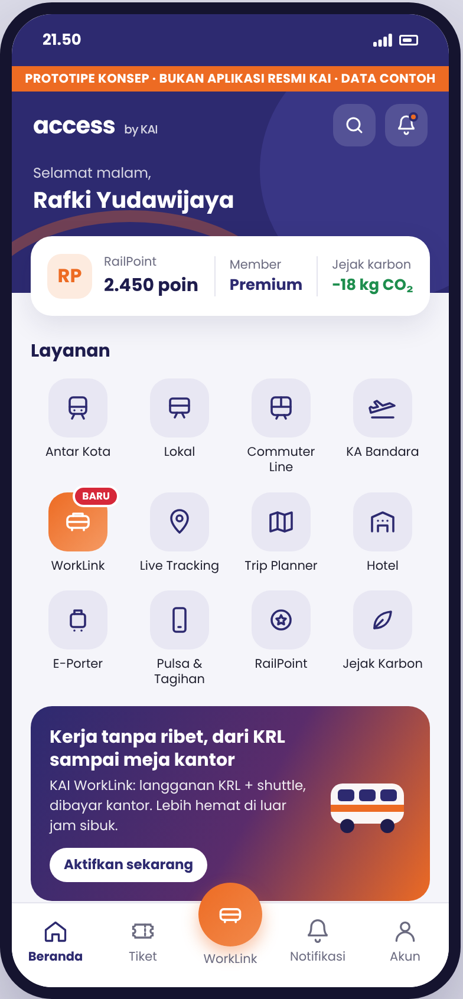
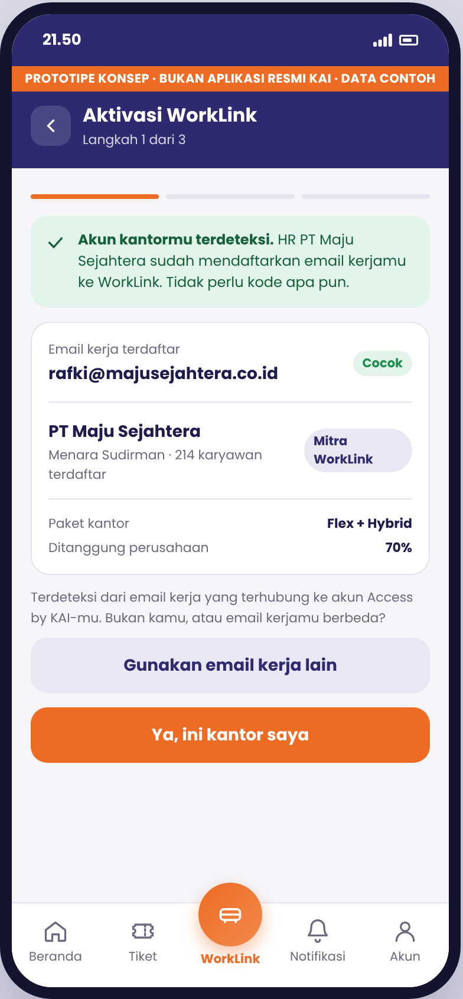
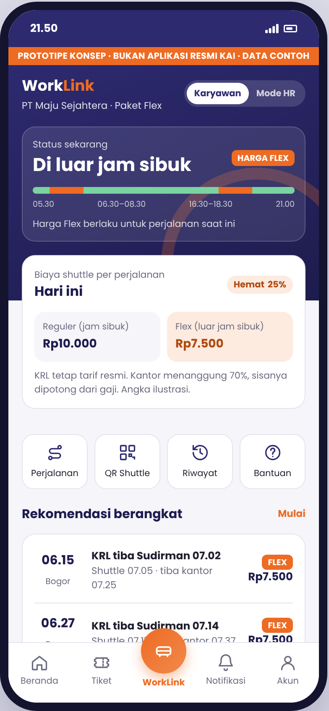
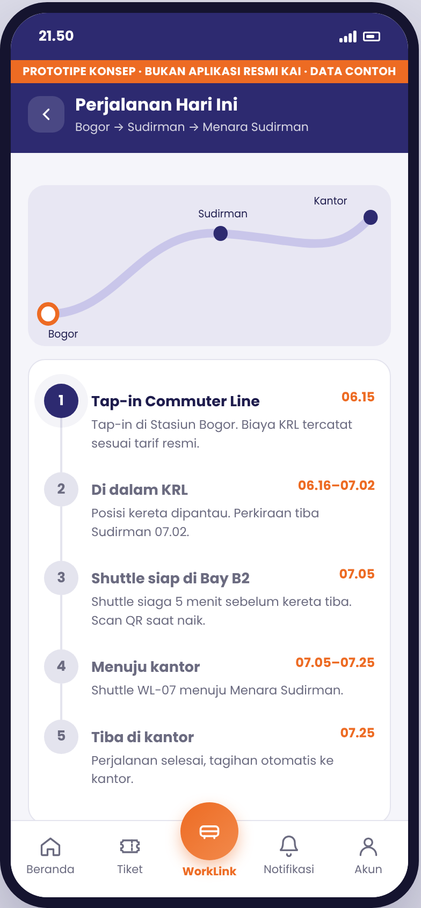
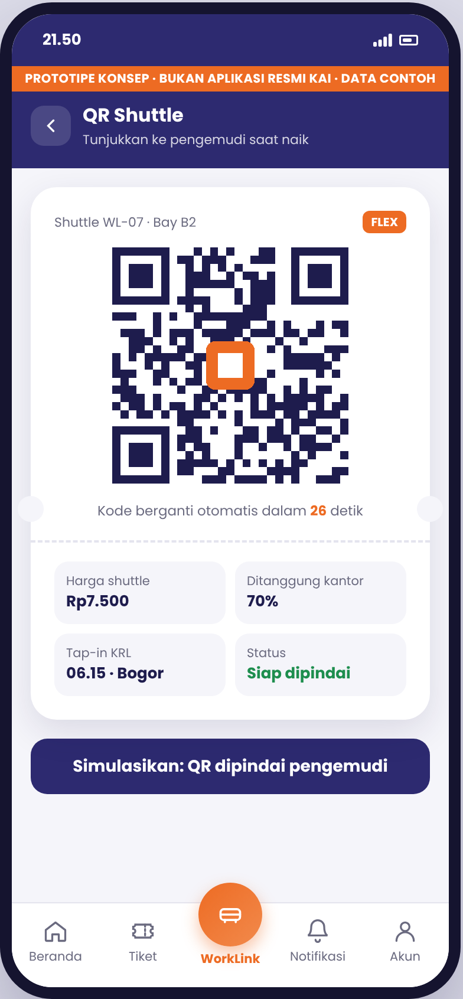
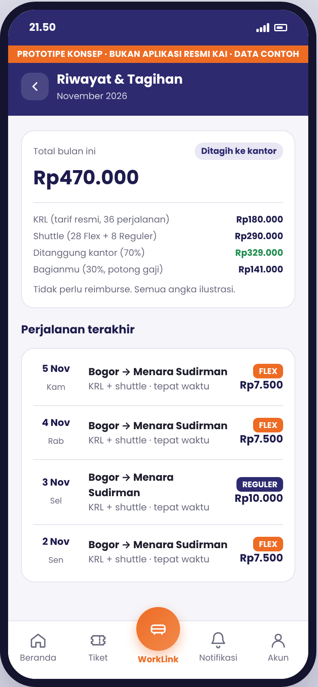
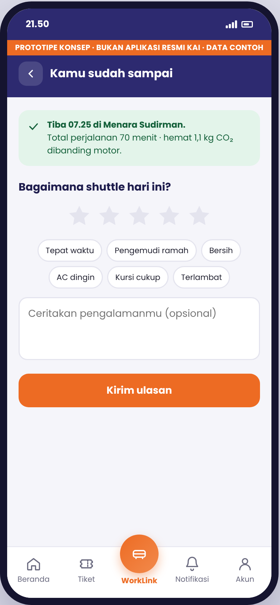
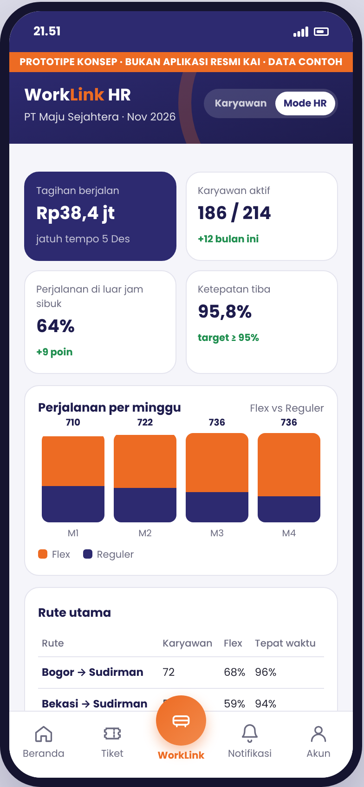

# KAI WorkLink – Prototipe Mobile

Prototipe konsep **KAI WorkLink** sebagai fitur baru di dalam aplikasi Access by KAI, dibuat oleh **Team LDR (BINUS University)** untuk Business Plan Competition ITB Insight 2026.

> Prototipe konsep, bukan aplikasi resmi PT Kereta Api Indonesia (Persero). Seluruh data, harga, dan nama perusahaan adalah contoh.

| Beranda | Aktivasi | WorkLink | Perjalanan |
| --- | --- | --- | --- |
|  |  |  |  |
| **QR Shuttle** | **Riwayat & Tagihan** | **Ulasan** | **Mode HR** |
|  |  |  |  |

## Konsep singkat

KAI WorkLink adalah paket langganan perjalanan kerja korporat: perjalanan Commuter Line ditambah shuttle dari stasiun ke kantor, dibeli perusahaan untuk karyawannya. Harga komponen shuttle lebih murah untuk perjalanan di luar jam sibuk (06.30–08.30 dan 16.30–18.30), sedangkan komponen Commuter Line tetap mengikuti tarif resmi. Karyawan tidak perlu kode apa pun: akun kantor terdeteksi otomatis dari email kerja yang didaftarkan HR.

## Menjalankan

Tidak perlu instalasi atau build.

- **Lokal:** buka `index.html` langsung di browser. Di laptop, tampilan muncul dalam bingkai ponsel; di HP, tampilan memenuhi layar.
- **Online (GitHub Pages):** di repo ini buka **Settings → Pages**, pada *Build and deployment* pilih **Source: GitHub Actions**. Setiap push ke `main` akan otomatis dideploy oleh `.github/workflows/pages.yml`.

Layar tertentu bisa dibuka langsung lewat hash URL: `#wl`, `#wl-onb`, `#wl-trip`, `#wl-qr`, `#wl-hist`, `#wl-rate`, `#hr`.

## Alur yang bisa dicoba

1. **Beranda** – fitur Access by KAI yang sudah ada (antar kota, lokal, Commuter Line, KA Bandara, Live Tracking, Trip Planner, hotel, E-Porter, pulsa dan tagihan, RailPoint, jejak karbon) ditambah menu **WorkLink**.
2. **Aktivasi** – akun kantor terdeteksi dari email kerja, atur rute dan titik jemput shuttle, pilih pola kerja (Flex, Reguler, Hybrid), lalu persetujuan data.
3. **Beranda WorkLink** – status jam sibuk mengikuti jam perangkat, harga Reguler vs Flex, rekomendasi keberangkatan, ringkasan bulanan.
4. **Perjalanan hari ini** – peta progres, timeline, info shuttle, simulasi tap-in sampai tiba, dan simulasi KRL terlambat.
5. **QR shuttle** – kode berganti setiap 30 detik.
6. **Ulasan** – rating bintang dan tag setelah tiba.
7. **Riwayat dan tagihan** – rincian KRL, shuttle, porsi kantor dan karyawan, dihitung otomatis dari konfigurasi.
8. **Mode HR** – tagihan berjalan, karyawan aktif, porsi perjalanan di luar jam sibuk, ketepatan tiba, rute utama, laporan emisi.

## Struktur proyek

```
kai-worklink/
├── index.html                 # kerangka halaman dan markup tiap layar
├── manifest.webmanifest       # bisa di-"Add to Home Screen" di HP
├── assets/
│   ├── css/
│   │   ├── base.css           # token warna, reset, bingkai ponsel
│   │   ├── components.css     # navigasi, header, kartu, tombol, form
│   │   └── worklink.css       # layar WorkLink, perjalanan, QR, HR
│   ├── js/
│   │   ├── config.js          # harga, porsi kantor, jam sibuk, data bulan (ubah di sini)
│   │   ├── state.js           # state global dan helper DOM
│   │   ├── ui.js              # navigasi layar, toast, bottom sheet fitur Access by KAI
│   │   ├── onboarding.js      # aktivasi via email kerja
│   │   ├── journey.js         # simulasi perjalanan dan keterlambatan KRL
│   │   ├── qr.js              # QR shuttle yang berganti otomatis
│   │   ├── notifications.js   # daftar notifikasi
│   │   ├── history.js         # riwayat perjalanan
│   │   ├── rating.js          # ulasan setelah tiba
│   │   ├── hr.js              # grafik dashboard HR
│   │   └── main.js            # jam, status jam sibuk, binding konfigurasi, inisialisasi
│   └── img/icon.svg
├── docs/screenshots/          # tangkapan layar untuk proposal dan pitch deck
└── .github/workflows/pages.yml
```

## Mengubah angka

Semua harga dan asumsi ada di `assets/js/config.js`:

```js
shuttle: { reg: 10000, flex: 7500 },  // harga shuttle per perjalanan
krlFare: 5000,                        // tarif KRL rute demo
companyShare: 0.7,                    // porsi ditanggung perusahaan
peak: [[390, 510], [990, 1110]],      // jam sibuk dalam menit (06.30–08.30, 16.30–18.30)
month: { days: 18, krlTrips: 36, flexTrips: 28, regTrips: 8 },
```

Harga di beranda WorkLink, QR, riwayat, tagihan, dan persentase porsi kantor akan ikut berubah. Samakan angka ini dengan bab Kelayakan Finansial di proposal.
